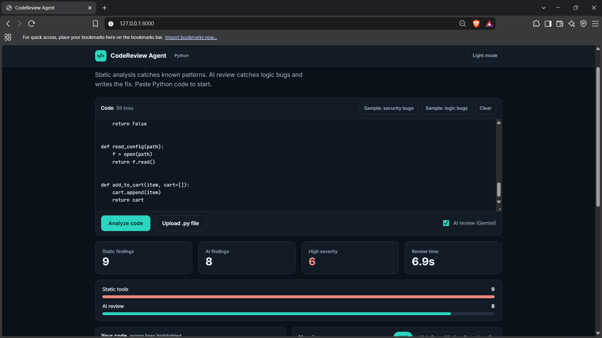

# AI Code Review & Bug Detection Agent

A hybrid code review tool that combines rule-based static analysis (pylint, bandit) with LLM reasoning (Google Gemini). It finds bugs, security issues and logic errors in Python code, highlights the wrong lines, shows the corrected version of each issue, and can generate a fully fixed file.



## Why hybrid?

- Static tools are fast and reliable for known patterns: SQL injection, hardcoded secrets, unsafe deserialization, weak hashing.
- They miss logic bugs. On a file with 9 logic bugs, pylint and bandit found none, and the LLM found 8.
- The LLM understands context, explains each issue, and suggests a fix.

## How it works

```
User input (paste / upload)
        |
Static analysis (pylint + bandit, run in parallel)
        |
LLM review (Gemini: code + static findings)
        |
Report (highlighted code, wrong vs correct, fixed file, JSON)
```

## Features

- Paste code, upload a `.py` file, or drag and drop it
- Static analysis with pylint and bandit
- LLM review with severity, category and explanation for every issue
- Full code view with wrong lines highlighted; click an issue to jump to its line
- Side-by-side **Wrong** and **Correct** version for each issue, with a copy button
- Filter issues by severity (High, Medium, Low)
- One-click fully corrected code, with copy and download
- Download the full report as JSON
- Light and dark theme

## Project structure

```
code-review-agent/
├── analyzer/
│   ├── static_analysis.py   # pylint + bandit
│   └── llm_review.py        # Gemini review and fix generation
├── static/
│   └── index.html           # web frontend
├── samples/                 # files with known bugs, used for testing
├── server.py                # FastAPI backend
├── app.py                   # alternative Streamlit UI
├── requirements.txt
└── .env                     # API key (not committed)
```

## Setup

```bash

git clone https://github.com/Kailashsharrma/ai-code-review-agent.git
cd ai-code-review-agent
python -m venv venv
venv\Scripts\activate
python -m pip install -r requirements.txt
```

Create a `.env` file in the project root:

```
GEMINI_API_KEY=your_key_here
```

Get a free key at https://aistudio.google.com/apikey

The model name is set in `analyzer/llm_review.py` (`MODEL`). Available models change over time, so check AI Studio if you get a 404 error.

## Run

Web app (FastAPI):

```bash
python -m uvicorn server:app --reload
```

Open http://127.0.0.1:8000

Alternative Streamlit UI:

```bash
streamlit run app.py
```

## Evaluation

I tested the agent on sample files with a known number of bugs (see `samples/`). "Static-only" counts real bugs flagged by pylint or bandit, and style warnings are not counted.

| Sample file | Real bugs | Static-only caught | Static + LLM caught |
|---|---|---|---|
| buggy1.py | 5 | 4 | 5 |
| buggy2.py | 4 | 1 | TBD |
| buggy3.py | 3 | 2 | 3 |
| buggy4.py | 10 | 5 | TBD |
| practice_logic.py | 9 | 0 | 8 |

False positives (LLM findings that were not real bugs): 1 on practice_logic.py, TBD on buggy4.py.

Examples:
- In `buggy1.py`, the static tools caught SQL injection, unsafe pickle, the hardcoded password and an unused import, but missed `x = 10 / 0`. The LLM caught it.
- In `practice_logic.py`, every bug is a logic bug (wrong formula, swapped arguments, wrong sort key). The static tools reported nothing, and the LLM found 8 of 9.

Speed: with a lite model, a full review of a small file takes about 3 to 5 seconds.

## Limitations

- Python only for now
- The LLM can report false positives or miss bugs, so findings need human review
- Severity labels can vary slightly between runs
- The generated "corrected code" can be wrong or incomplete. Always read it before using it
- Very large files are not chunked yet
- Free-tier API rate limits apply
- Code is sent to the Gemini API, so do not review private or sensitive code
- The server has no login or rate limiting, so run it locally only

## Future work

- Support for more languages (AI review for any language, ESLint and other tools for static checks)
- GitHub pull request bot
- Re-run static analysis on the generated fix to verify it
- Automated evaluation script for precision and recall

## Tech stack

Python, FastAPI, Streamlit, pylint, bandit, Google Gemini API (`google-genai`), HTML and JavaScript